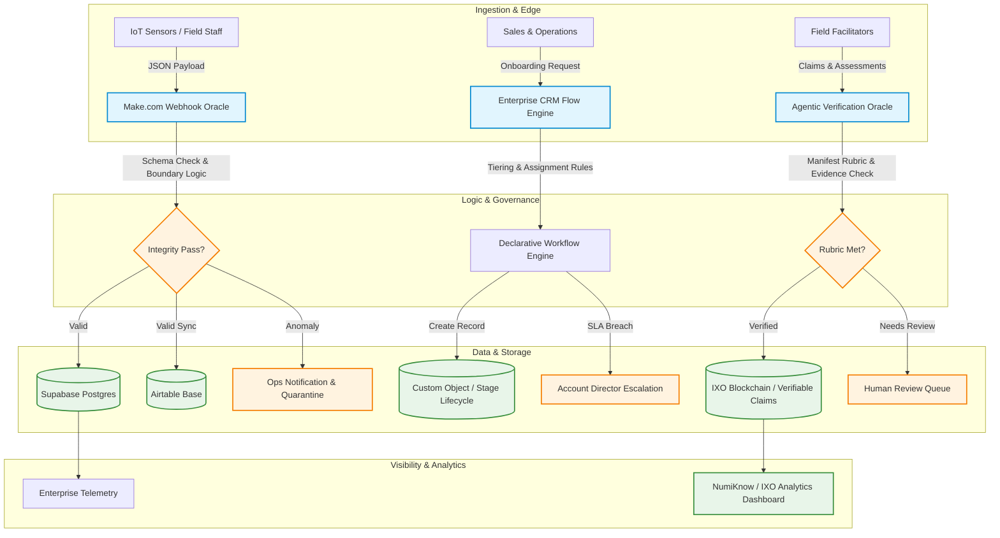

# Solutions Engineering & Enterprise Platform Portfolio
> **Candidate Portfolio:** Technical Solutions Consultant | Solutions Engineer | Platform Integration Specialist  
> **Focus Areas:** Event-Driven Webhooks, Declarative CRM Engineering, Verifiable Data Oracles, GraphQL Analytical Dashboards, Human-in-the-Loop Automation.

---

## 🧭 Executive Summary

Welcome to my Solutions Engineering and Platform Integration portfolio. As a Solutions Engineer, I specialize in the critical bridge between complex technology and business outcomes: **orchestrating systems, designing data contracts, enforcing data integrity, and creating transparent analytical visibility.**

This repository contains four enterprise-grade projects demonstrating end-to-end solutions architecture:

1. [**The Automated Data Validation & Webhook Oracle**](./project-1-webhook-oracle/): Event-driven ingestion pipeline with automated JSON schema validation, anomaly routing, and dual-database sync (Supabase & Airtable).
2. [**Enterprise CRM Custom Object & Process Automation Engine**](./project-2-enterprise-crm-engine/): Declarative business process architecture, automated lead tiering, SLA escalations, and custom object lifecycle tracking.
3. [**IXO Analytical & Provenance Dashboard**](./project-3-ixo-analytics-dashboard/): Multi-source impact data dashboard querying Blocksync GraphQL, Cosmos Authz grants, and verifiable claims for educational outcomes.
4. [**The Agentic Verification Oracle**](./project-4-agentic-verification-oracle/): Deterministic rubric evaluation pipeline enforcing policy manifests, automated incentive calculation, and human-in-the-loop escalation.

---

## 🏗️ Architecture Overview

---

## 📂 Portfolio Matrix & Core Capabilities

| Project | Problem Solved | Core Technologies | Key Business Metric |
| :--- | :--- | :--- | :--- |
| **[1. Webhook Validation Oracle](./project-1-webhook-oracle/)** | Malformed data & anomalies corrupting backend databases | Make.com, Webhooks, Supabase (SQL), Airtable, Postman | 100% invalid payload quarantine; 0 dirty records in DB |
| **[2. Enterprise CRM Engine](./project-2-enterprise-crm-engine/)** | Manual client onboarding delays & SLA drop-offs | Salesforce Flow, HubSpot, Data Modelling, Mockaroo | 70% reduction in lead-to-onboarding cycle time |
| **[3. IXO Analytical Dashboard](./project-3-ixo-analytics-dashboard/)** | Opaque impact claims & funder reporting overhead | Blocksync GraphQL, JavaScript (ES6+), CSS3 Design System | Real-time multi-tier trust provenance for 1,000+ claims |
| **[4. Agentic Verification Oracle](./project-4-agentic-verification-oracle/)** | Subjective, slow manual evaluation of field evidence | Verifiable Rubrics, Cosmos Authz, Policy Manifests | 85% automated instant verification with audit trails |

---

## 🛠️ Tech Stack & Integration Toolkit

- **Workflow & Orchestration:** Make.com (Integromat), Zapier, Salesforce Flow Builder, Webhooks, REST APIs.
- **Data & Databases:** Supabase (PostgreSQL), Airtable, Blocksync GraphQL, JSON Schema (Draft-07).
- **APIs & Testing:** Postman (Collections, automated test scripts, pre-request scripts), cURL, HTTP status codes (`200`, `400`, `422`).
- **Web & Front-end:** JavaScript (Modern ES Modules), Vanilla HTML5/CSS3, SVG Data Visualizations, JetBrains Mono & Plus Jakarta Sans typography.
- **Enterprise Solutions Methodology:** Discovery, Proof of Concept (PoC) delivery, Data Contract definition, SLA monitoring, Human-in-the-Loop (HITL) exception handling.

---

## 🚀 How to Review This Portfolio

1. **Test the Webhook Oracle:** Import the [Postman Collection](./project-1-webhook-oracle/postman_collection.json) to run automated test cases against live or mock webhook endpoints.
2. **Review Database DDL:** Inspect the [Supabase SQL Schema](./project-1-webhook-oracle/supabase_schema.sql) with strict check constraints and audit timestamps.
3. **Explore the CRM Process:** Walk through the [Salesforce / CRM Data Dictionary & Architecture](./project-2-enterprise-crm-engine/README.md).
4. **Experience the Live Analytics Dashboard:** Review the [NumiKnow IXO Analytical Dashboard](./project-3-ixo-analytics-dashboard/README.md) designed for multi-tier stakeholder verification.
5. **Read the Interview Cheatsheet:** See the [STAR Method Interview Playbook](./interview-prep/STAR_METHOD_SCRIPTS.md) for how each project is presented in technical interviews.
