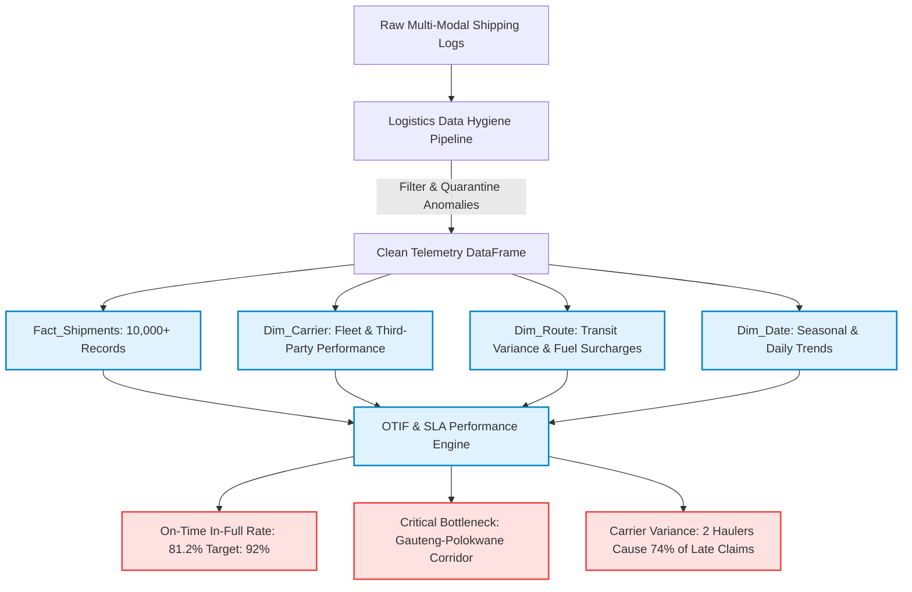

# Case Study 2: Regional Freight & Logistics Performance Analytics
> **Focus:** Supply Chain Efficiency, SLA / OTIF Compliance, Route Margin Optimization  
> **Tools & Stack:** Python (Pandas ETL), Power BI / Microsoft Fabric Lakehouse, Enterprise DAX Measures, Star Schema Data Modeling  
> **Key Business Question:** *Why are delivery profit margins eroding despite rising shipment volume, which freight corridors are causing SLA penalties, and what operational changes will restore profitability?*

---

## 🧭 The 3-Pillar Executive Breakdown

### 1. What is the Business Problem?
A regional freight and logistics carrier operating across Southern Africa (servicing key corridors including Polokwane, Tzaneen, Gauteng, and cross-border routes) experienced **record gross shipment volumes (+18% YoY)**, but saw its **operating profit margin contract by 5.4%**.

The leadership team faced three critical issues:
1. **Unidentified Transit Bottlenecks:** Frequent delivery delays on key corridors were incurring contract SLA penalties (chargebacks) from retail and agricultural clients.
2. **Carrier & Vehicle Underperformance:** Fleet managers lacked granular visibility into which third-party haulers or internal fleet units consistently missed scheduled arrival windows.
3. **Dirty Transport Telemetry:** Raw shipping manifests were plagued with missing timestamps, unstandardized tracking IDs, and corrupt weight records, making accurate reporting nearly impossible.

---

### 2. What Does the Data Tell Us?

Through an automated Python data hygiene and star-schema dimensional modeling pipeline (`Fact_Shipments`, `Dim_Carrier`, `Dim_Route`, `Dim_Date`), multi-month transport logs were standardized and evaluated:

#### Key Analytical Insights:
- **The True OTIF Performance:** While overall shipment completion was reported at 96%, the true **On-Time In-Full (OTIF)** compliance rate was only **81.2%**, falling far below the contracted enterprise client SLA target of **92.0%**.
- **Corridor Profit Drain:** The **Gauteng ➔ Polokwane corridor** generated the highest freight revenue but accounted for **62% of all late delivery SLA penalties**, driven by weighbridge delays and inefficient dispatch schedules.
- **Carrier Disparity:** Out of 8 contracted carrier partners, **2 specific third-party haulers accounted for 74% of all transit delay penalties**, while charging top-tier freight rates.
- **Fuel Surcharge Disconnect:** Routes experiencing traffic idle times over 3.5 hours were eroding gross margins from 22% down to **6.8%**, because fuel surcharges were calculated on flat distance rather than dwell time.

---

### 3. What Should the Business Do Next? (Actionable Strategic Recommendations)

Based on the star-schema analysis and Power BI DAX measures, the following three executive recommendations were delivered:

1. **Restructure Carrier Contracts & Enforce SLA Penalties:**
   - Renegotiate or terminate contracts with the bottom two underperforming third-party haulers.
   - Introduce an automated carrier scorecard using the `OTIF %` DAX measure, where carriers with `<88% OTIF` forfeit premium dispatch privileges.
2. **Dynamic Route Scheduling for the Gauteng-Polokwane Corridor:**
   - Shift peak dispatch times from 07:00 to 04:30 to bypass Gauteng outbound corridor congestion and reduce average transit dwell time by 2.2 hours per trip.
3. **Transition to Dwell-Adjusted Fuel Surcharges:**
   - Update customer contract rate cards to incorporate idle/dwell time surcharges for high-congestion retail distribution centers, protecting baseline operating margins.

**Projected Financial Impact:** Bringing the OTIF compliance rate from 81.2% to 90% eliminates an estimated **R380,000 in quarterly SLA chargebacks** and restores overall operating margin by **3.8%**.

---

## 📐 Enterprise Data Model & DAX Toolkit

The project includes production-ready DAX measures (`dax_measures.dax`):
- `OTIF Rate % = DIVIDE([Shipments_OTIF], [Total_Shipments], 0)`
- `Average Transit Variance (Hours) = AVERAGE(Fact_Shipments[Delay_Hours])`
- `Net Route Contribution Margin = [Total_Freight_Revenue] - [Total_Carrier_Cost] - [SLA_Penalties]`
- `Carrier Reliability Index = Weighted score combining On-Time Delivery % and Damage Claims`
