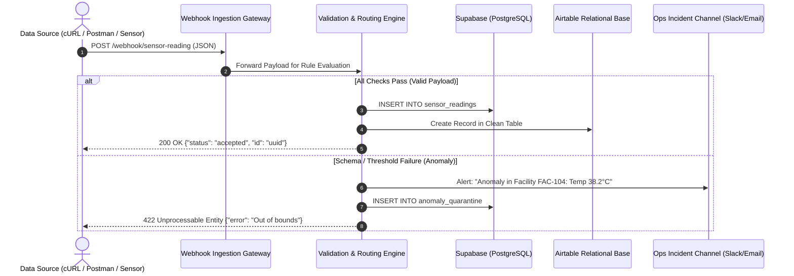

# Project 1: The Automated Data Validation & Webhook Oracle

> **Domain:** Event-Driven Architecture, API Integration & Data Integrity  
> **Target Roles:** Integration Specialist, Solutions Engineer, Platform Engineer  
> **Key Skills:** Webhooks, JSON Schema (Draft-07), Conditional Routing, Anomaly Quarantine, Multi-Target Database Sync.

---

## 📌 Executive Problem Statement

In enterprise environments, upstream field applications and IoT devices continuously push telemetry and operational reports via HTTP. When incoming data lacks strict schema enforcement at the perimeter, dirty records (such as negative sensor values, missing critical IDs, or malformed timestamps) infiltrate core databases. 

Fixing downstream corrupted data costs enterprises hundreds of hours in manual database cleanup and damages business reporting trust.

### The Solution
An event-driven **Webhook Oracle and Data Firewall** built with low-code orchestration (Make.com/Zapier), backed by strict relational database constraints (Supabase/PostgreSQL & Airtable). The pipeline:
1. Listens for external POST events at a secure webhook endpoint.
2. Evaluates the incoming JSON payload against strict business rules and range thresholds.
3. Automatically normalizes and writes clean records to relational databases.
4. Quarantines anomalies, dispatches real-time Slack/Email alerts with incident payloads, and responds with appropriate HTTP status codes (`200 OK`, `400 Bad Request`, `422 Unprocessable Entity`).

---

## 🏛️ System Architecture



---

## 📋 Data Contract & Validation Specification

The pipeline strictly enforces the following schema:

| Attribute | Data Type | Constraint / Validation Rule | Rejection Behavior |
| :--- | :--- | :--- | :--- |
| `event_id` | UUIDv4 | Must exist, must match `^[0-9a-f-]{36}$` | 400 Bad Request |
| `facility_id` | String | Must match pattern `^FAC-[0-9]{3}$` | 422 Unprocessable Entity |
| `reading_timestamp` | ISO 8601 | Valid datetime string; cannot be in future | 422 Unprocessable Entity |
| `temperature_c` | Float | Value must be between `-25.0` and `15.0` | 422 Unprocessable Entity & Alert |
| `humidity_pct` | Float | Value must be between `0.0` and `100.0` | 422 Unprocessable Entity & Alert |
| `sensor_status` | String | Must be in `['ONLINE', 'CALIBRATING', 'DEGRADED']` | 422 Unprocessable Entity |

---

## 🛠️ Step-by-Step Implementation Guide

### Step 1: Setting up the Database Layer

#### Option A: Supabase (PostgreSQL)
1. Log into your free Supabase account and open the **SQL Editor**.
2. Run the provided script in [`supabase_schema.sql`](./supabase_schema.sql).
3. This creates two tables:
   - `sensor_readings` (clean, verified records with `CHECK` constraints).
   - `anomaly_quarantine` (audit trail for rejected events).

#### Option B: Airtable Base
1. Create a base named **Cold Chain Telemetry Oracle**.
2. Create table **Sensor Readings** with columns:
   - `Event ID` (Single line text)
   - `Facility ID` (Single line text)
   - `Timestamp` (Date / ISO string)
   - `Temperature (°C)` (Number - decimal)
   - `Humidity (%)` (Number - decimal)
   - `Sensor Status` (Single select: `ONLINE`, `CALIBRATING`, `DEGRADED`)
3. Follow the detailed [Airtable Setup Guide](./airtable_setup_guide.md).

---

### Step 2: Configuring Make.com (Integromat)

1. **Webhook Listener:** Add module `Webhooks > Custom Webhook`.
   - Name: `sensor-telemetry-oracle`.
   - Copy the live webhook URL generated by Make.com.
2. **Router Setup:** Add a `Flow Control > Router` immediately after the webhook.
3. **Route 1: Valid Path (Pass)**
   - **Filter Condition:**
     - `temperature_c` >= `-25` AND `temperature_c` <= `15`
     - `humidity_pct` >= `0` AND `humidity_pct` <= `100`
     - `facility_id` starts with `FAC-`
     - `event_id` exists
   - **Action 1:** Supabase / Airtable — Create record.
   - **Action 2:** `Webhooks > Webhook Response`:
     - Status: `200`
     - Body:
       ```json
       {
         "status": "success",
         "message": "Telemetry verified and recorded",
         "event_id": "{{1.event_id}}",
         "ingested_at": "{{now}}"
       }
       ```
4. **Route 2: Anomaly / Quarantine Path (Fail)**
   - **Filter Condition:** Fallback route OR invert logic (`temperature_c` > `15` OR `temperature_c` < `-25`).
   - **Action 1:** Slack / Email notification to Ops channel:
     - Message: `🚨 [ANOMALY DETECTED] Facility {{facility_id}} reported abnormal temp: {{temperature_c}}°C at {{reading_timestamp}}. Quarantined.`
   - **Action 2:** Supabase — Insert into `anomaly_quarantine`.
   - **Action 3:** `Webhooks > Webhook Response`:
     - Status: `422`
     - Body:
       ```json
       {
         "status": "rejected",
         "error": "INTEGRITY_VIOLATION",
         "message": "Payload violated cold chain temperature or schema rules",
         "event_id": "{{1.event_id}}"
       }
       ```

---

## 🧪 Testing with Postman & cURL

Import the [`postman_collection.json`](./postman_collection.json) into Postman to run automated regression tests against your webhook.

### Test cURL 1: Valid Payload (Should return `200 OK`)
```bash
curl -X POST "https://hook.eu2.make.com/YOUR_WEBHOOK_ID" \
  -H "Content-Type: application/json" \
  -d @payloads/valid_sensor_payload.json
```

### Test cURL 2: Temperature Out of Range (Should return `422 Unprocessable Entity`)
```bash
curl -X POST "https://hook.eu2.make.com/YOUR_WEBHOOK_ID" \
  -H "Content-Type: application/json" \
  -d @payloads/invalid_anomaly_payload.json
```

---

## 🎯 Interview Talking Points (Solutions Engineer)

> *"In this project, I built an event-driven validation oracle that serves as an intelligent firewall for incoming IoT and field data. Instead of allowing malformed or anomalous data to reach our production Postgres and Airtable data stores, the pipeline inspects every payload in flight against strict business rules.*
> 
> *Clean records are normalized and committed synchronously with a 200 response, while threshold breaches—like refrigeration failure—trigger immediate operational alerts and quarantine logging with a 422 status code. This pattern protects database integrity and cuts downstream data maintenance costs to zero."*
