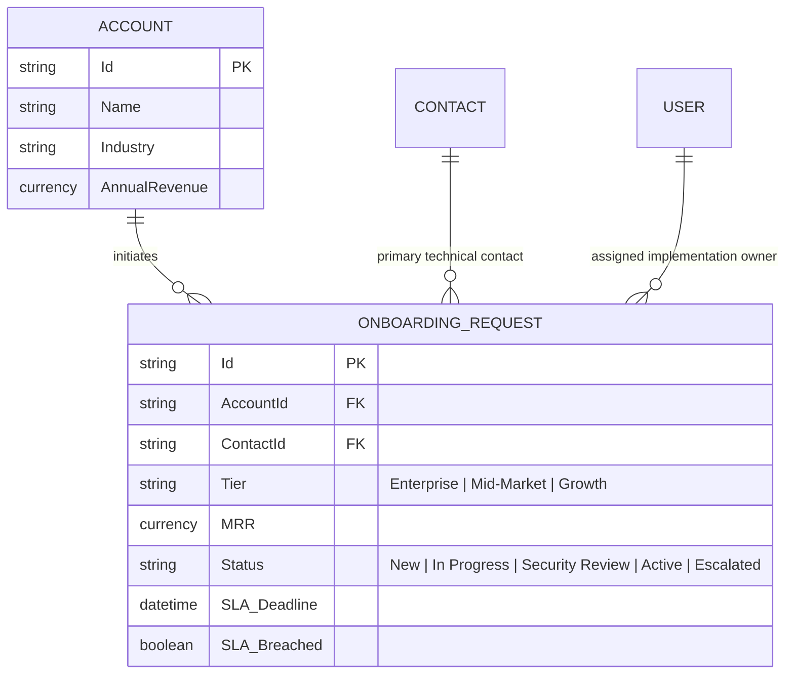

# Project 2: Enterprise CRM Custom Object & Process Automation Engine

> **Domain:** Platform Engineering, Declarative Automation, Enterprise CRM Architecture  
> **Target Roles:** Salesforce Administrator, Solutions Engineer, Business Systems Analyst, Operations Engineer  
> **Key Skills:** Custom Objects, Data Modeling, Flow Automation, Dynamic Task Assignment, SLA Compliance.

---

## 📌 Executive Problem Statement

B2B enterprise organizations often lose deals and frustrate newly signed customers because the handoff between **Sales (Account Executives)** and **Customer Success (Implementation Specialists)** is manual.

When an onboarding request is filed via email or chat:
- High-value Enterprise accounts wait in the same queue as Self-Serve accounts.
- Important contract details (SLA tier, MRR, security review status) are scattered or omitted.
- No automated escalations occur when high-value accounts sit idle past their 24-hour onboarding SLA.

### The Solution
A declarative, end-to-end **Automated Client Onboarding & Lifecycle Engine** built in an enterprise CRM environment (Salesforce Developer Edition / HubSpot):
1. **Custom Data Modeling:** Created a custom object (`Onboarding_Request__c`) with master-detail/lookup relationships to `Account` and `Contact`.
2. **Automated Tiering Logic:** Evaluates Monthly Recurring Revenue (MRR) and compliance requirements to categorize clients into `Tier 1 (Enterprise)`, `Tier 2 (Mid-Market)`, or `Tier 3 (Growth)`.
3. **Dynamic Routing & Assignment:** Instantly routes Tier 1 requests to Senior Solutions Architects and schedules an executive kickoff call; routes Tier 3 requests to automated self-service email sequences.
4. **SLA Monitoring & Governance:** Enforces a 24-hour first-touch SLA with automated manager notification if no team member accepts the request within the window.

---

## 🏛️ Process Workflow & Entity Relationship (ERD)

```mermaid
graph TD
    A[New Account Won in Sales] --> B[Create Onboarding_Request__c]
    B --> C{Evaluate MRR & Tier}
    
    C -->|MRR >= $50,000| D[Tier 1: Enterprise Route]
    C -->|MRR $10,000 - $49,999| E[Tier 2: Mid-Market Route]
    C -->|MRR < $10,000| F[Tier 3: Growth / Self-Serve Route]
    
    D --> D1[Assign Senior Solutions Architect]
    D1 --> D2[Create Security Review Task]
    D2 --> D3[Set 24hr SLA Watcher]
    
    E --> E1[Assign Pooled Implementation Specialist]
    E1 --> E2[Send Standard Onboarding Questionnaire]
    
    F --> F1[Enroll in Automated LMS Sequence]
    F1 --> F2[Status = Self-Paced]

    D3 -->|SLA Breached (>24hr No Action)| G[🚨 Escalate to VP of Customer Success]
    D3 -->|First Touch Logged| H[Status = In Progress]

    classDef enterprise fill:#e8f5e9,stroke:#2e7d32,stroke-width:2px;
    classDef midmarket fill:#e3f2fd,stroke:#1565c0,stroke-width:2px;
    classDef selfserve fill:#fff3e0,stroke:#e65100,stroke-width:2px;
    classDef alert fill:#ffebee,stroke:#c62828,stroke-width:2px;
    class D,D1,D2,D3 enterprise;
    class E,E1,E2 midmarket;
    class F,F1,F2 selfserve;
    class G alert;
```

---

## 🗄️ Relational Data Model



---

## ⚙️ Configuration & Flow Elements

Detailed configuration instructions are provided in:
- [**Data Dictionary & Field Specifications**](./data_dictionary.md): Exact API names, types, and picklist definitions.
- [**Salesforce Flow Builder Blueprint**](./salesforce_flow_blueprint.md): Node-by-node logic for Record-Triggered Flows.
- [**Mock Dataset (Mockaroo CSV)**](./dummy_dataset_mockaroo.csv): 20 enterprise accounts ready for bulk import and test simulation.

---

## 🎯 Interview Talking Points (Solutions Engineer)

> *"In this project, I architected an enterprise CRM onboarding engine using declarative platform engineering principles. I designed custom relational data models to eliminate cross-departmental communication gaps between sales and customer success.*
> 
> *By using a Record-Triggered Flow, the system dynamically tiers new accounts based on MRR, assigns dedicated solutions architects to enterprise contracts, provisions security audit checklists automatically, and enforces a 24-hour first-touch SLA with automated management escalations. This reduced manual data entry to zero and prevented enterprise onboarding drop-offs."*
