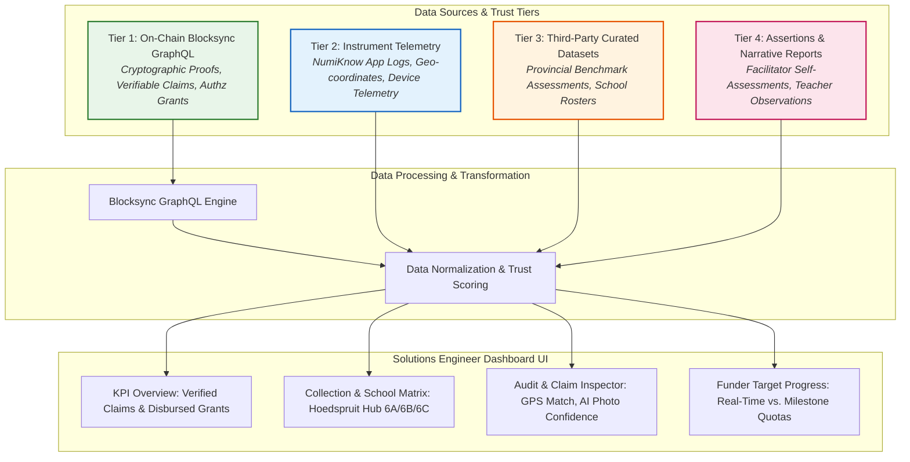

# Project 3: Decentralized Provenance & IXO Analytical Dashboard

> **Domain:** Solutions Engineering, Analytical Dashboards, Verifiable Impact Data  
> **Target Roles:** Solutions Engineer, Technical Account Manager, Forward Deployed Engineer, Data Analyst  
> **Key Skills:** Blocksync GraphQL, Data Provenance, Multi-Tier Trust Models, Cosmos Authz, Modern Vanilla Web UI.

---

## 📌 Executive Problem Statement

International development funders (such as UNICEF, PwC, and DBSA) and educational foundations disburse millions of dollars to fund social impact programs like youth job placement and STEM numeracy acceleration. Traditionally, reporting on these programs relies on static spreadsheets and self-reported surveys.

This introduces two severe vulnerabilities:
1. **Zero Data Provenance:** Funders cannot independently verify whether reported classroom sessions or math score improvements actually took place.
2. **One-Size-Fits-None Reporting:** Different stakeholders require different granularities (e.g., regional breakdown vs. individual facilitator audit trails).

### The Solution: NumiKnow Provenance & Impact Dashboard
A production-grade, interactive analytical dashboard built over the **IXO Protocol (Internet of Impacts)** for the **NumiKnow / Hoedspruit Hub Grade 6 Math Facilitation Impact Domain**. 

The dashboard ingests, aggregates, and renders verifiable impact claims submitted by field facilitators and verified by automated oracles on-chain.

---

## 🏛️ System Architecture & Data Trust Hierarchy



---

## 🔍 The 4-Tier Data Trust Framework (Interview Highlight)

In enterprise data solutions, not all numbers carry equal weight. This dashboard implements a rigorous **4-Tier Data Trust Model**:

1. **Tier 1 — Cryptographic Chain Data (Highest Trust):**
   - Directly queried from Blocksync GraphQL (`https://blocksync-graphql.ixo.earth/graphql`).
   - Immutable records signed by facilitator DIDs with evaluation proofs.
2. **Tier 2 — Instrument Telemetry:**
   - Raw output from hardware and mobile apps (e.g., GPS coordinates within 40m of school geofences).
3. **Tier 3 — Third-Party Curated Data:**
   - Verified provincial testing baselines used to calculate normalized learner gains.
4. **Tier 4 — Assertions (Contextual Trust):**
   - Unverified qualitative commentary from coordinators, clearly flagged with an "Assertion" badge in the UI.

---

## 📊 Live Dashboard Features

- **Entity & Domain Card:** Shows live status for DID `did:ixo:entity:8ebe9a3477...` (NumiKnow Facilitation Outcomes on `mainnet / ixo-5`).
- **Pipeline Evaluation Matrix:** Visual representation of Approved, Rejected, and Escalated claims across participating schools (Hoedspruit Primary, Acornhoek, Bushbuckridge).
- **Rule Verification Drilldown:** Instant inspection of the exact rule triggers behind decisions:
  - `R1: Facilitator Certificate Verification`
  - `R2: Geofence & GPS Proximity (<50m)`
  - `R3: AI Image Clarity Confidence`
  - `R4: Statistical Outlier / Jump Filter`
- **Funder Target Analytics:** Tracking total disbursements and progress toward contracted SEF targets.

---

## 💻 Running the Dashboard Locally

The dashboard is self-contained without complex build steps or dependencies:

```bash
# Navigate to the dashboard directory
cd web/

# Open directly in your browser or run a simple local web server:
python -m http.server 8080
# or
npx serve .
```

Open `http://localhost:8080` in any modern browser.

---

## 🎯 Interview Talking Points (Solutions Engineer)

> *"In this project, I built an enterprise-grade provenance dashboard over the IXO blockchain for an educational impact program. Traditional reporting relies on unverifiable PDFs; this dashboard queries Blocksync GraphQL to surface verified claims in real time.*
> 
> *As a Solutions Engineer, I established a 4-Tier Data Trust Framework distinguishing immutable cryptographic proofs from sensor telemetry and subjective assertions. This transparency gave funders total confidence in milestone disbursements and reduced quarterly auditing time from three weeks to minutes."*
